

  

<h1 align="center">Docalto</h1>

  <b>PC-class PDF tools in one Android app. Offline on your phone by default, no account.</b> 
  Read, edit, sign, scan, compress and convert PDFs and Office files. By <a href="https://github.com/1tordroid">Tordroid</a>.

  
  
  
  
  

  <a href="https://play.google.com/store/apps/details?id=com.tordroid.docalto"><b>Get it on Google Play</b></a> ·
  <a href="#join-testing">Join testing</a> ·
  <a href="https://docalto.tordroid.com/">Website</a> ·
  <a href="COMPARISON.md">Compare</a> ·
  <a href="CHANGELOG.md">Changelog</a> ·
  <a href="https://docalto.tordroid.com/privacy/">Privacy</a> ·
  <a href="https://t.me/Docalto_tordroid_Playstore">Telegram</a>

  

Docalto puts your everyday document jobs in one fast app: read, edit, sign, scan, compress, merge, split and convert PDFs, and open Word, Excel and PowerPoint files too. Your documents are handled on your phone and not uploaded unless you turn on an online feature. There is no account. Most tools are free; a few use one short ad, and Premium removes the ads and the daily limit. While Docalto is in testing, PRO tools are free to use.

> This repository holds Docalto's release notes, changelog and screenshots. It has **no source code and no APK**. Docalto is available only from Google Play.

## Why Docalto

**PC-class PDF tools in one Android app, running offline on the phone by default with no account, which very few apps offer.**

Many PDF websites upload your file to merge, split, compress or convert it. Many desktop programs already do those jobs offline on a computer. Docalto runs that kind of toolkit on an Android phone, on the device.

- **Desktop-class jobs on the phone:** split by size, pages on one sheet, booklet order, PDF/A, compare and repair, all on device. Common on desktop, uncommon in an Android app that needs no account.
- **Flow:** several tools in one run on the phone. Similar workflows elsewhere run in the cloud or on a server you host.
- **File Rescue** and a wide image-format list (RAW previews, Photoshop, JPEG XL, TIFF and older formats).
- **Offline signature checks** against India's CCA roots, including many Aadhaar PDFs.
- **On-device AI:** Gemini Nano summaries and answers when the model is on the phone, with a built-in fallback on every other phone.
- **New in 2.1.0:** Study tools (flashcards, quiz and outline from a PDF), text reading for 11 more languages such as Arabic, Urdu, Bengali, Tamil, Telugu and Russian, and a Pro Camera with Macro and Night.

### Online and AI, honestly

- **Offline:** every tool, text reading, summaries (Gemini Nano, or key sentences on other phones), Ask this PDF, Study tools and signatures.
- **With your own AI key** (Gemini, Grok, Claude or ChatGPT) and online turned on: chat with PDF, online summary, rewrite, translation and page text reading. Docalto asks before the first use.
- **Coming soon** (needs a Docalto server): exact Office layout, sign by link, review by link, and online AI without your own key.

Full, sourced comparison (as of November 2026): [COMPARISON.md](COMPARISON.md). Docalto has no iOS or desktop app and no cloud sync, and it does not replace a desktop suite like PDF24 Creator or a self-hosted Stirling PDF.

## New in 2.1.0

- **Seven colour themes**, and **Recent** at the bottom of Home with View more. Settings is one tap away on every tab.
- **Study tools:** flashcards, a quiz and an outline made on the phone from a PDF.
- **Text reading for 11 more languages**, including Arabic, Urdu, Bengali, Tamil, Telugu and Russian, after a one-time download.
- **Pro Camera** with Macro, Night and adjustable corners.
- **Measure, Reading view, fillable forms, Pictures in PDF, Web page to PDF**, a visual Compare report and review file (XFDF) import.
- **PDF to Word, Excel and PowerPoint** export every page.
- Root or hook frameworks on the phone no longer stop the app; only tampering with Docalto does.
- What's new and Why Docalto in all 15 app languages.

## New in 2.0.1

- **Scan button** in the middle of the bottom bar (Home, My Files, Scan, All Tools, Flow). Scan a document straight to PDF at full quality, or scan a **QR code or barcode**.
- **Next steps after a scan:** save as PDF, extract text, sign, compress, merge, edit, protect or share. A finished file from any tool goes straight into the next tool.
- **Links from codes ask first:** the full link is shown with Open, Copy or Cancel. Scanned codes are kept in a history on the phone.
- **Works without Google Play services:** LineageOS, AOSP and other de-Googled phones get an in-app camera scanner for documents and codes. Only then does Docalto ask for the camera.
- **Voice search** with a mic button, and a **What's new** screen in Settings with a Why Docalto card.
- **Fixes:** Play installs on Android 17 no longer say "modified copy"; PDFs from many photos save again at full original quality; tapping a tool no longer reads its name aloud; the related tools strip no longer covers Edit PDF labels on smaller screens.

All versions: [CHANGELOG.md](CHANGELOG.md) · [Releases](https://github.com/1tordroid/Docalto-Releases/releases)

## Features

**Scan and QR**
- Scan documents, books, ID and business cards to PDF at full quality; whiteboard filter, ID front and back on one page, business card to contact.
- QR codes and barcodes from the camera, a gallery photo or inside PDFs. Open links, email, phone, UPI and maps in one tap, or copy the contents.
- Next steps after every scan, and an in-app scanner for phones without Google Play services.

**Read**
- Pinch and double-tap zoom, sharp up to 10×. Go to page, thumbnails, contents, bookmarks, search inside the PDF.
- Night and sepia modes. Read aloud with an offline voice, plain-text view. Select text on the page, then copy or translate it.

**Edit and sign**
- Edit existing text in its original font, find and replace, AI scan to edit text in scanned pages.
- Pen, highlight, underline, strikethrough, text, shapes, arrows, notes, whiteout. Markup removal in one step.
- Your signature, remembered. Digital ID signatures, with an optional timestamp (only a hash is sent).

**Organize and convert**
- Merge without quality loss, split by pages or by size, reorder, rotate, delete pages, pages on one sheet, booklet order, batch jobs.
- Images to PDF, PDF to JPG or one long image, extract images, crop margins, compare two PDFs, page numbers, Bates numbers, forms, watermark studio.
- PDF/A-2b archive copies. Read DOC, DOCX, XLS, XLSX, PPT, PPTX, OFD, TXT and CSV; Word to PDF; PDF to Word, Excel and PowerPoint with layout kept.

**Compress**
- Three PDF levels, photos by quality or size, or hit an exact size like 200 KB for forms.

**Smart tools (offline AI)**
- Summary and Ask this PDF, key info (dates, amounts, invoice numbers), auto-redact personal details, read handwriting, OCR and translate on the phone, smart file names.

**Flow and My Files**
- Flow runs several tools on one file, with ready-made flows and your own.
- My Files: one library for your documents, find words across recent PDFs.

**Almost any picture**
- JPG, PNG, WebP, GIF, HEIC, AVIF, JPEG 2000, JPEG XL, every TIFF page, Photoshop, SVG, EMF, WMF, camera RAW previews and older professional formats. File Rescue for damaged files.

**Security**
- Password-protect PDFs (AES-256), remove a password you know, repair damaged PDFs, remove hidden details.
- Verify signatures offline, including India's CCA roots. Optional app lock with fingerprint or screen lock; saved PDF passwords are encrypted.

**Your look**
- Light, dark, AMOLED black or follow your phone; wallpaper colours on Android 12+; seven home-screen icons. 15 languages.

## Screenshots

Docalto 2.1.0

  
  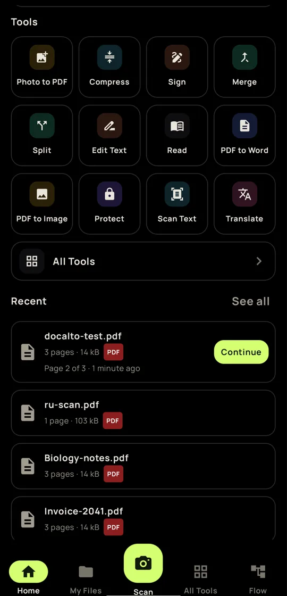
  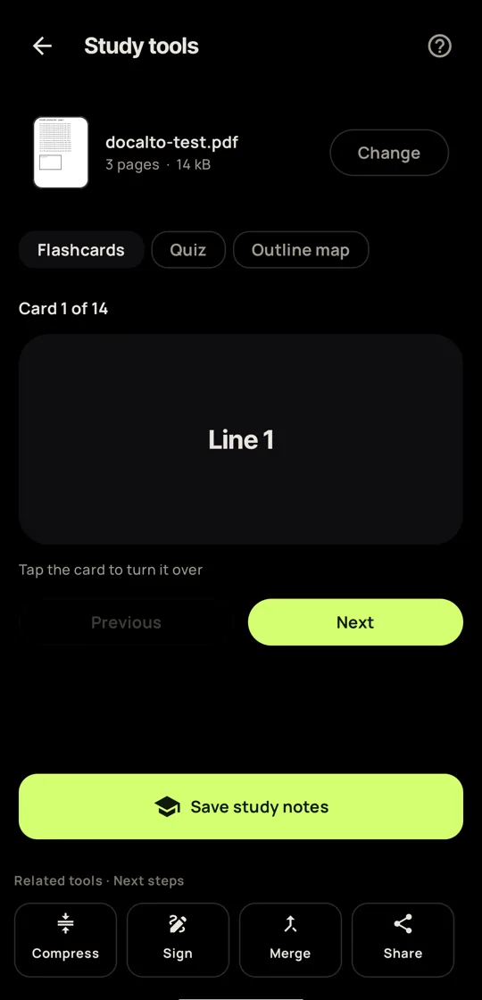
  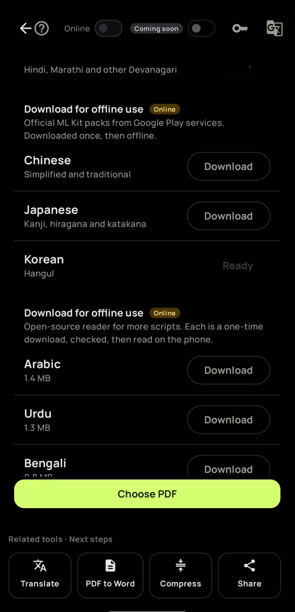

  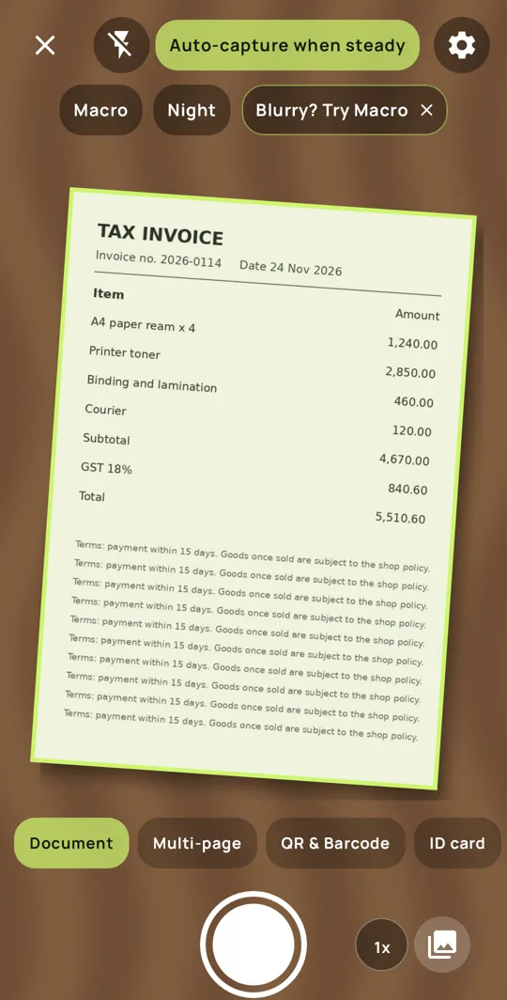
  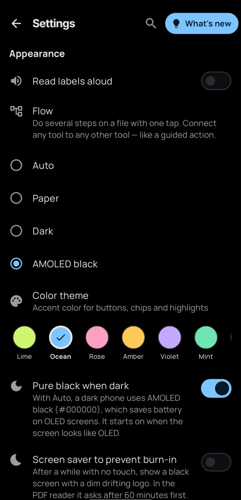
  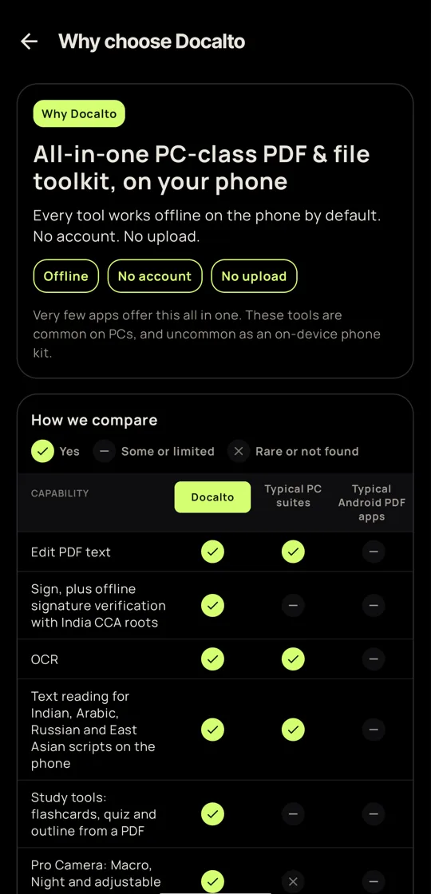
  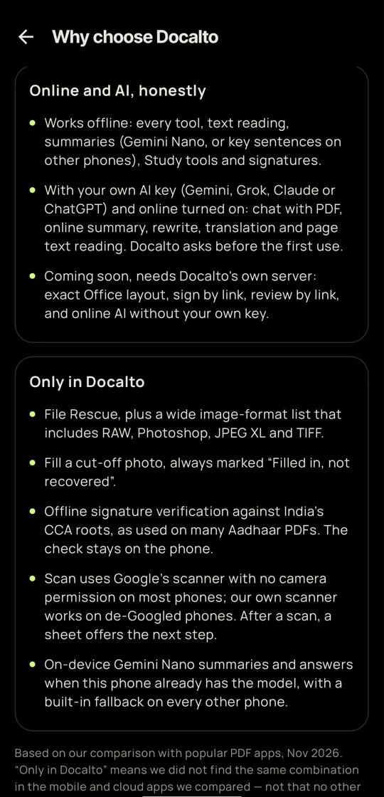
  

Docalto 2.0.1 screenshots

Light theme

  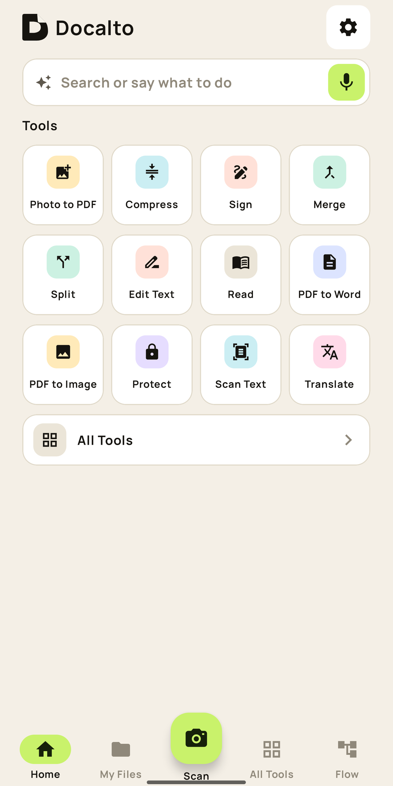
  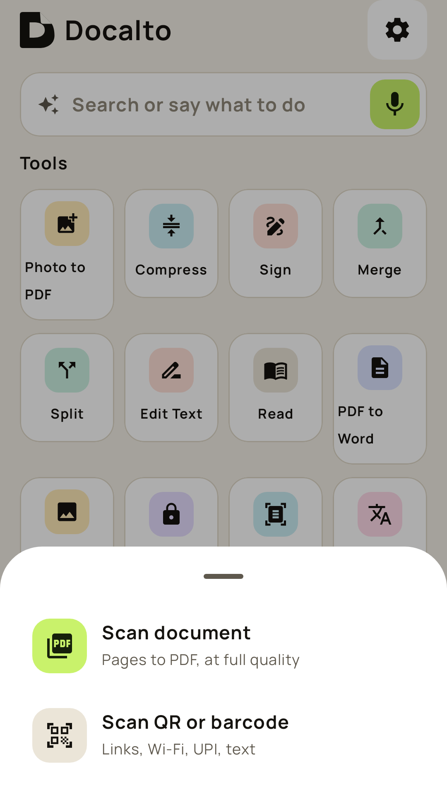
  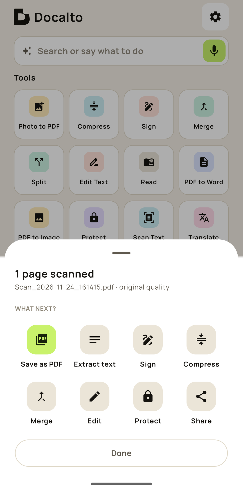
  

  
  
  
  
  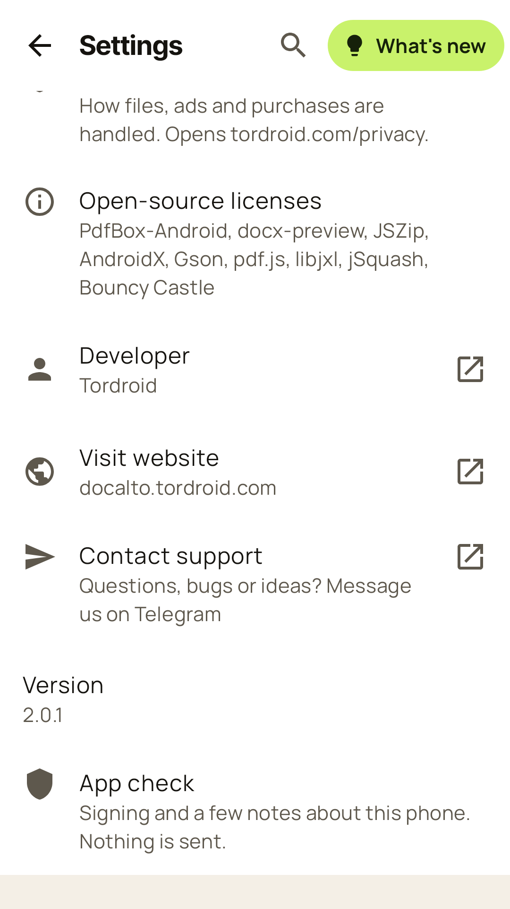

Dark theme

  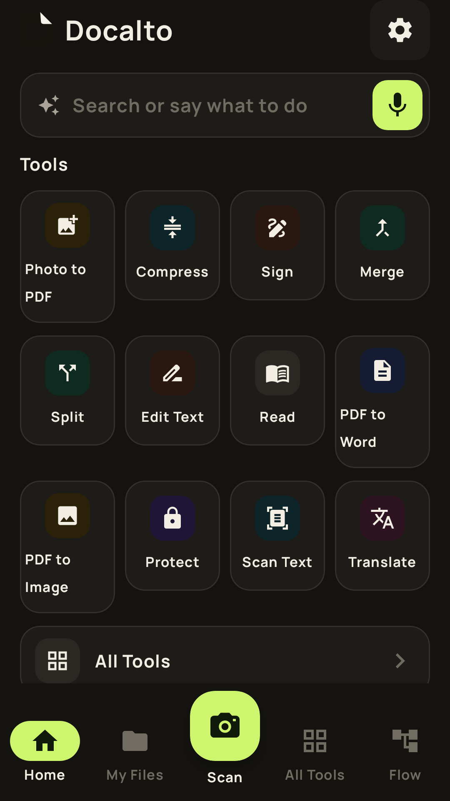
  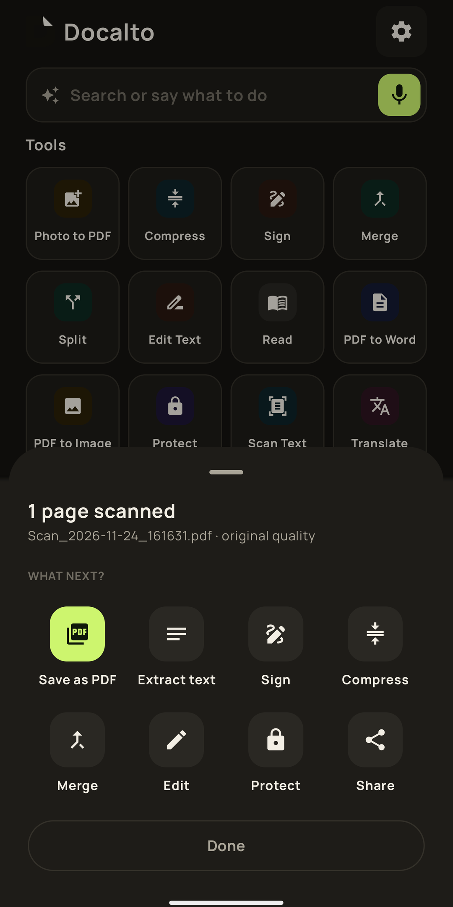
  
  

Screenshots of Docalto 2.0.1 from Google Play, taken on a OnePlus 12: Home, Scan, the next steps after a scan, Edit PDF, the QR link prompt, All Tools, What's new, Settings and About.

2.1.0 screenshots were taken on a OnePlus 12. The Pro Camera picture is the app's camera screen drawn over a sample invoice.

## Get Docalto

Docalto **2.1.0** is in **internal and closed testing on Google Play** and will be open to everyone soon. It is distributed only through Google Play; there is no APK download.

### Join testing

1. Join the tester group **[docalto-testers](https://groups.google.com/g/docalto-testers)** with your Google account.
2. Open the **[Docalto test page](https://play.google.com/apps/testing/com.tordroid.docalto)**, tap **Become a tester**, then install Docalto from **[Google Play](https://play.google.com/store/apps/details?id=com.tordroid.docalto)**.

Requires Android 8.0 or later.

## Privacy

Viewing, editing, converting, scanning, OCR and translation run on the device. Docalto does not upload, share or collect your documents unless you turn on an online feature and agree, and there is no account. The free version shows Google AdMob ads, which may collect device data; Premium has no ads. Full details: [privacy policy](https://docalto.tordroid.com/privacy/) · [terms](https://docalto.tordroid.com/terms/) · [SECURITY.md](SECURITY.md).

## Support

- Telegram channel: https://t.me/Docalto_tordroid_Playstore
- Support: https://t.me/Tordroid_admin
- Website: https://docalto.tordroid.com/

## Follow Tordroid projects

- GitHub: https://github.com/1tordroid
- All apps: https://tordroid.com/
- Droid Stream: https://droidstream.tordroid.com/

## License

Copyright © 2026 Tordroid. All rights reserved. Docalto is not open source. The files here may be viewed and linked to, but not copied or redistributed. See [LICENSE](LICENSE).

Google Play and the Google Play logo are trademarks of Google LLC.
