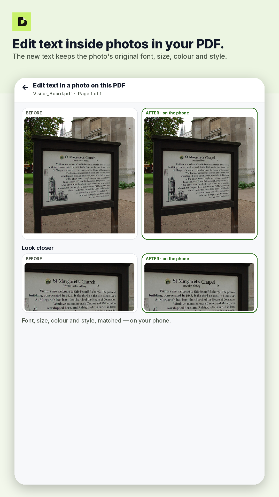
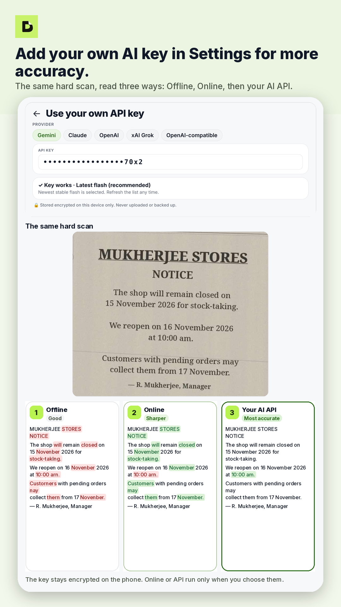

# Docalto 2.6.1

versionName **2.6.1**, versionCode **17**. 26 November 2026 (Asia/Calcutta, IST). Uploaded to closed testing (Alpha) on Google Play and sent for review.

## Highlights

- **Edit text in photos.** Change words in a scanned page or a photo in your PDF, and keep the original font, size and colour. OCR and inpainting run on the phone.
- **Online AI, off until you allow it.** A switch on Home and in Settings covers AI, translation and cloud tools. When you turn it on, AI can step into tools, flows and search.
- **Your own AI key.** Gemini, Claude, OpenAI, Grok (xAI), or an OpenAI-compatible model. Keys stay encrypted on the phone. No Docalto account.

## Highlight screenshots

  
  

## Also in this release

- Why choose Docalto now compares Docalto with leading Android apps and PC software (Acrobat Pro, FineReader PDF, Foxit PDF Editor, PDFelement, Nitro PDF Pro, PDF24 Creator, WPS Office and Microsoft 365 Word), notes where desktop tools go further, and keeps “Only in Docalto” limited to the Android apps compared. See [COMPARISON.md](../COMPARISON.md).
- The screens added in 2.6 are translated into all 15 app languages: Marathi, Gujarati, Bengali, Punjabi, Odia, Tamil, Telugu, Kannada, Malayalam, Arabic, Urdu, Russian and Simplified Chinese, alongside English and Hindi.
- Terms of use: sections 6 to 8 (Good to know, Our responsibility, If these terms change) use friendlier, clearer wording with the same legal effect.

## App signing

The app on Google Play is signed by Google Play with this app signing certificate SHA-256: `B7:59:9C:08:92:2C:8D:E8:2B:DD:31:6A:AC:47:76:D0:18:16:56:AC:29:C8:2E:6E:C6:6F:42:19:87:CE:4E:D6`.

Get Docalto from [Google Play](https://play.google.com/store/apps/details?id=com.tordroid.docalto). Website: [docalto.tordroid.com](https://docalto.tordroid.com/).

Requires Android 8.0 or later. Available on [Google Play](https://play.google.com/store/apps/details?id=com.tordroid.docalto) (closed testing — Alpha). Website: [docalto.tordroid.com](https://docalto.tordroid.com/). Comparison (Android apps and PC software, November 2026): [COMPARISON.md](../COMPARISON.md).
